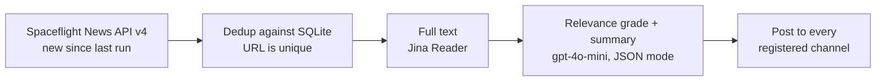

# Iris

A Discord bot that watches spaceflight news for AFROTC i5 squadrons. Every ten minutes it pulls new articles, keeps the ones that matter to Space Force-track cadets, writes a two to three line summary, and posts it to every server that has installed it.

## How it works

The pipeline is a LangGraph graph in `main.py`. The Discord side is in `bot.py`.



1. **fetch** pulls the latest articles and keeps only ones published since the last run that aren't already in the database. The first run looks back 15 minutes so it doesn't dump a backlog.
2. **get_md** fetches each article's full text through Jina Reader.
3. **decision_model** asks gpt-4o-mini, in JSON mode, whether the article is relevant (military space, leadership, aerospace engineering, national security) and, if so, for a short summary. Failures are skipped, not posted.
4. **bot.py** runs the graph off the event loop every 10 minutes and posts each approved article to every registered channel.

## Multi-tenant by design

Each article is fetched and graded once, then fanned out to every server. Adding servers adds Discord messages, not model calls, so the LLM cost stays flat as more squadrons install it.

- `/setup #channel` picks where news is posted. It requires the Manage Server permission.
- When the bot is removed from a server, that server's row is deleted.

## Running it

```bash
python3 -m venv .venv && source .venv/bin/activate
pip install -r requirements.txt
cp .env.example .env   # add OPENAI_API_KEY, JINA_API_KEY, DISCORD_BOT_TOKEN
python3 bot.py
```

The bot creates `space_articles.db` on first run. Invite it with the URL in `website/src/lib/constants.ts`, then run `/setup` in your server.

## Website

`website/` is the landing page squadrons use to add the bot: Vite, React, TypeScript, Tailwind and Framer Motion.

```bash
cd website && npm install && npm run dev
```

## Status

Runs locally. Always-on hosting is the next step.
